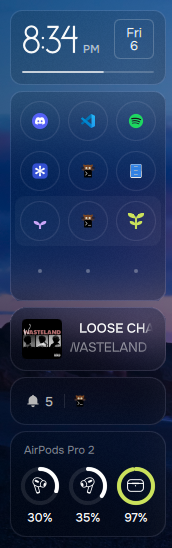
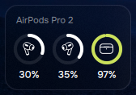
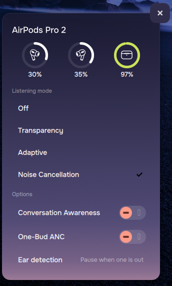
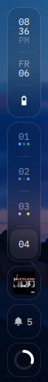

# AirPods for Pond

AirPods battery and controls in the Pond OS sidebar.

## Screenshots

| In the sidebar | The card | The flyout | Collapsed sidebar |
|:---:|:---:|:---:|:---:|
|  |  |  |  |

The card is lime while charging, as the case is here, and coral at 20% or below.

- **Sidebar card:** a battery ring for the left pod, the right pod and the case, each with its icon inside and the
  percentage below. The card collapses to a single ring with the sidebar, shows lime while charging and coral at 20%
  or below, and hides itself when no AirPods are connected.
- **Flyout:** click the card to open it beside the sidebar. It has larger rings and the controls the AirPods have:
  - listening mode (Off, Transparency, Adaptive, Noise Cancellation, only the ones the model supports)
  - the adaptive noise level slider
  - Conversation Awareness
  - One-Bud ANC
  - ear detection (pause when one pod is out, when both are out, or never)
- **Pause on removal:** the daemon pauses media when a pod comes out and can resume it when it goes back in.

It is built from Pond's own pieces (`Card`, `PanelBackground`, `Toggle`, `Slider`, the theme colours), so it follows
the active theme.

BlueZ does not report battery for AirPods, so a small daemon talks to them directly. See
[docs/daemon-notes](docs/daemon-notes) for why.

## Requirements

- Pond OS with the stock `pond-shell` (Quickshell) sidebar
- AirPods paired and connected through BlueZ
- Build packages: `cmake ninja qt6-connectivity qt6-tools qt6-declarative pkgconf libpulse`

## Install

Two steps. The first runs as you, the second needs root.

```
sudo pacman -S cmake ninja qt6-connectivity qt6-tools qt6-declarative pkgconf libpulse
./install.sh                 # build and start the daemon (under ~/.local)
sudo ./install-system.sh     # add the widget to the sidebar and install the pacman hook
```

The running shell normally reloads by itself when the files change, so the card appears without a restart. If it does
not, restart the shell:

```
pkill -f '^qs -c pond-shell'; setsid qs -c pond-shell -d >/dev/null 2>&1 &
```

### What it changes

**As you (`install.sh`)**, all under `~/.local`: the daemon and `librepods-ctl` in `bin/`, a systemd user unit
(enabled and started), and translations. The upstream tray app's launcher entry is removed, since the widget replaces it.

**As root (`install-system.sh`)**:

1. Copies the tools to `/usr/local/lib/pond-pods/`, owned by root. The pacman hook runs them as root, so it must never
   run a file from a folder a normal user can write to.
2. Installs `/etc/pacman.d/hooks/pond-pods.hook`.
3. Adds the widget to the system shell in `/usr/share/pond-interface/shell`: it copies `airpods/` in and applies
   [`patches/sidebar.patch`](patches/sidebar.patch) to `Sidebar.qml`.

The patch is the only edit to a file the `pond-shell` package ships. It adds 21 lines and rewrites 7, so the flyout
opens and closes like the wifi, audio and bluetooth ones.

The package database is not touched, so `pacman -Qkk pond-shell` will list `Sidebar.qml` as modified while the patch
is applied.

## Updates

The widget is added to the real shell, not to a copy, so Pond updates reach you.

An update restores the stock `Sidebar.qml`, which removes the patch. The pacman hook runs
`/usr/local/lib/pond-pods/apply.sh` after every `pond-shell` install or upgrade and adds the widget again. You only
need to restart the shell afterwards, the same as after any Pond update.

If Pond has changed the lines of `Sidebar.qml` that the patch edits, the patch no longer applies. `apply.sh` then
changes nothing, says so, and the shell keeps working without the widget until `patches/sidebar.patch` is updated.

To add the widget by hand, for example after updating this repository:

```
sudo ./install-system.sh
```

## Uninstall

```
sudo ./uninstall-system.sh   # undo the patch, delete airpods/, remove the hook and /usr/local/lib/pond-pods
./uninstall.sh               # stop and remove the daemon
```

Restart the shell afterwards. If the patch cannot be undone cleanly, `uninstall-system.sh` stops before removing
anything else, and `sudo pacman -S pond-shell` restores the stock files. If the shell will not draw, switch to a TTY
(Ctrl+Alt+F3) and run one of those.

## How it works

```
AirPods --L2CAP/BLE--> librepods daemon --> ~/.local/state/librepods/status.json
                              ^                          |
                       librepods-ctl <-- airpods/State.qml (watches the file, sends commands)
                                                         |
                                            airpods/Widget.qml, Panel.qml
```

The daemon writes its whole state as one JSON line whenever it changes. `State.qml` watches that file, so the widget
runs nothing while idle, and sends commands (`noise:anc`, `ear:one`, `adaptive:50`, ...) through `librepods-ctl`.
Pausing media is done by the daemon itself over MPRIS.

## Models and icons

Icons live in `airpods/assets/models/<model-slug>/`, named after the model the daemon reports
(`AirPods Pro 2` becomes `airpods-pro-2`). To add a model, add a folder with `pod-left.svg`, `pod-right.svg`,
`case.svg` and an `ATTRIBUTION.md`. No code changes are needed. See
[airpods/assets/models/README.md](airpods/assets/models/README.md). A model with no folder shows the AirPods Pro 2
icons. AirPods Max has no pods or case, so it uses Pond's headphone icon.

## Status

Developed and used on one machine: Pond OS with niri, AirPods Pro 2, North theme.

Verified on that machine with the system install: `install-system.sh` added the card to the running shell, which
reloaded without a restart and logged no errors, and `pacman -Qkk pond-shell` then listed only `Sidebar.qml` as
modified.

The flyout and its controls were also tested by hand on the system install and work. Pausing when a pod is removed
was checked on an earlier install of the same code that ran from a copy of the shell. The case battery showed a real
value (97%, charging) in the screenshots above, and the collapsed sidebar was checked by eye: the card shrinks to a
single ring that shows the lowest battery. The ring has no icon inside yet.

**Not tested:** the pacman hook firing on a real `pond-shell` upgrade, the other Pond themes (the ring colours were picked for a dark theme), any other AirPods
model, multiple monitors.

The scripts were tested against temporary folders, including with a simulated `pond-shell` update, an update that
conflicts with the patch, and under `fakeroot` for ownership.

### Known issues

- **Low-battery notifications do not appear.** The daemon sends them with the `omarchy` command, which Pond does not
  have, so it only logs a warning. It would need to use the desktop notification service instead.
- **Pausing failed once** after a Bluetooth link drop and reconnect, and worked after the daemon restarted. The
  daemon's log showed it had not yet matched the AirPods to an audio card at that moment. The cause is not confirmed.
  If it happens, `systemctl --user restart librepods` fixes it.
- **The daemon picks the highest-bitrate Bluetooth profile** (SBC-XQ) and re-applies it on every activation, so the
  audio profile may differ from before.
- **A model with no icon folder** makes Qt log a "Cannot open" warning before it falls back to the default icons.
- **A patched system file.** Anything that checks `/usr` against the package, such as `pacman -Qkk`, will report
  `Sidebar.qml`. A Pond-side extension point for sidebar cards would remove the need for the patch.

## Credits and licences

This repository mixes three licences.

| Part | Licence | Origin |
|---|---|---|
| `airpods/` QML (`Model.js`, `State.qml`, `Widget.qml`, `Panel.qml`, `Ring.qml`, `PartIcon.qml`), scripts, patch | MIT, see [LICENSE](LICENSE) | `Model.js` and `State.qml` are adapted from [omarchy-pods](https://github.com/thisisgm/omarchy-pods) by GM (MIT). The rest is new, though the flyout's sections and show/hide rules follow omarchy-pods' `Panel.qml`. |
| `daemon/` | GPL-3.0, see [daemon/LICENSE](daemon/LICENSE) | A modified copy of [librepods](https://github.com/kavishdevar/librepods) by Kavish Devar, as modified in omarchy-pods. Details in [daemon/UPSTREAM.md](daemon/UPSTREAM.md). Reverse-engineering Apple's protocol is his work. |
| `airpods/assets/models/airpods-pro-2/` icons | CC BY 3.0 | Noun Project: pods by 우가 우가, case by Alebaer. See that folder's `ATTRIBUTION.md`. Keep it with the icons. |

The daemon runs as its own process and talks to the QML only through a file and a command, so the GPL part and the
MIT part stay separate.

`docs/daemon-notes` are verified notes on the AirPods and the daemon, carried over from omarchy-pods. They mention
Omarchy where they describe its tools.
